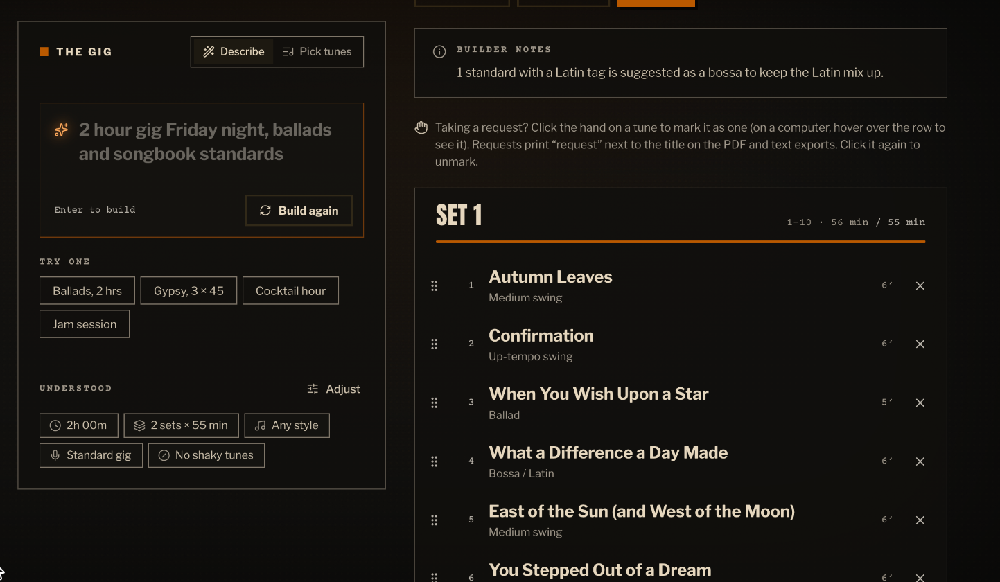
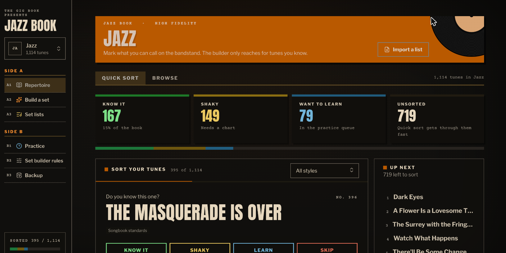
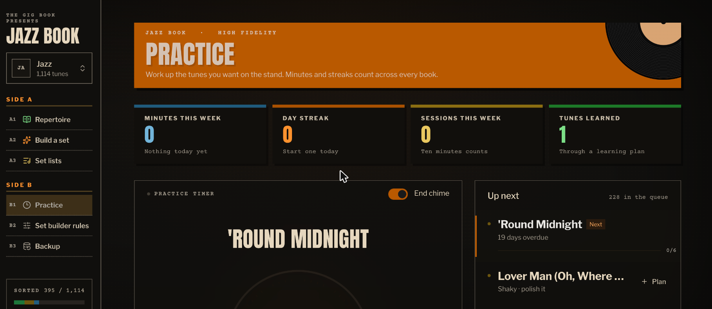

# Set List Generator (The Gig Book)

**A set list builder I made for my own jazz gigs.** Mark the tunes you can call on the bandstand, describe the gig in plain English, and it builds paced sets from your repertoire, with backups ready.



The Jazz Book holds **1,114 standards** tagged by style (swing, bebop, ballads, bossa, gypsy jazz, trad, modal and more). There are 11 other genre books, about 4,500 songs in all. It's a static Next.js + TypeScript app with no backend and no account; everything is saved in your browser.

## How it works

**1. Sort your repertoire.** Quick Sort shows one tune at a time: *Know it*, *Shaky*, *Learn* or *Skip*, each one key press. The builder only reaches for tunes you actually know.



**2. Describe the gig the way you'd text the band.**

| You type | It understands |
|---|---|
| `2 hour gig Friday night, ballads and songbook standards` | 2 h, 2 sets × 55 min, Friday's date, ballad + songbook styles |
| `Gypsy jazz gig Saturday, 3 x 45` | 3 sets of 45 min, gypsy jazz |
| `1 hour cocktail hour at a wedding, bossa and swing` | 1 h of quieter background playing, latin + swing |
| `Jam session tonight, 8 tunes, bebop and hard bop` | an 8-tune list, longer solos |

The parser is plain TypeScript rules, not an AI model, so it's instant, works offline, and is fully covered by tests.

**3. The engine builds the night.** It:
- opens strong and closes hot with your surest up-tempo tunes
- paces the feels (ballads, medium swing, bossa, waltzes, up-tempo). It caps how many ballads, or tunes with the same feel, play in a row, and keeps two tunes in the same key from going back to back. Every limit can be changed on the *Set builder rules* page.
- fills each set to time, using a per-tune length that changes with the room (a jam stretches tunes, background music shortens them)
- keeps shaky tunes away from the openers and closers, or leaves them out entirely
- leaves notes on its choices ("1 standard with a Latin tag is suggested as a bossa to keep the Latin mix up")

You can then drag tunes between sets, swap in backups, mark audience requests, and export to **text or a printable PDF**. Builds are deterministic by seed: the same request gives the same list, and *Shuffle* gives a fresh one.

**4. Practice.** Tunes marked *Learn* or *Shaky* go into a practice queue with a timer, streaks and per-tune learning plans.



## Engineering notes

- **Tested engine.** About 1,000 lines of [Vitest](https://vitest.dev) tests cover the gig-text parser, the set builder (timing, pacing, determinism), the rule checks, text/PDF export and practice scheduling.
- **Pure core, thin UI.** `src/lib/engine/` is framework-free TypeScript: request in, set list out. The React components only render and edit its output.
- **Data with sources.** Tune credits (composer, lyricist, year, famous recordings) were gathered by `scripts/research/` from Wikidata and Wikipedia, with source links kept per tune. Anything filled in from general knowledge is marked *unverified* in the app.
- **Design system.** It's styled after a 1950s–60s record jacket, and each genre book gets its own colors and typeface. See [DESIGN.md](DESIGN.md).

## Run it

```bash
npm install
npm run dev      # http://localhost:3000
npm test         # engine, export and practice tests
npm run build    # static site in ./out, host anywhere
```

## Layout

```
src/app/              routes: genre picker, /repertoire, /build, /sets, /practice, /rules, /backup
src/lib/engine/       set-list builder, gig-text parser and rules (pure TypeScript, tested)
src/lib/export/       text formats and the PDF
src/lib/practice.ts   practice queue, streaks and learning plans
src/data/genres/      the song catalog, one JSON file per genre (loaded on demand)
src/components/       UI grouped by screen
scripts/research/     the tune-credit research pipeline
```

## Background

I play jazz gigs, and building set lists the night before was always the same chore: remember what I can actually play, avoid three ballads in a row, and make the timing work. I built this with an AI coding assistant (Claude) as my pair programmer. I set the product direction and gig logic, and we wrote the code together.
